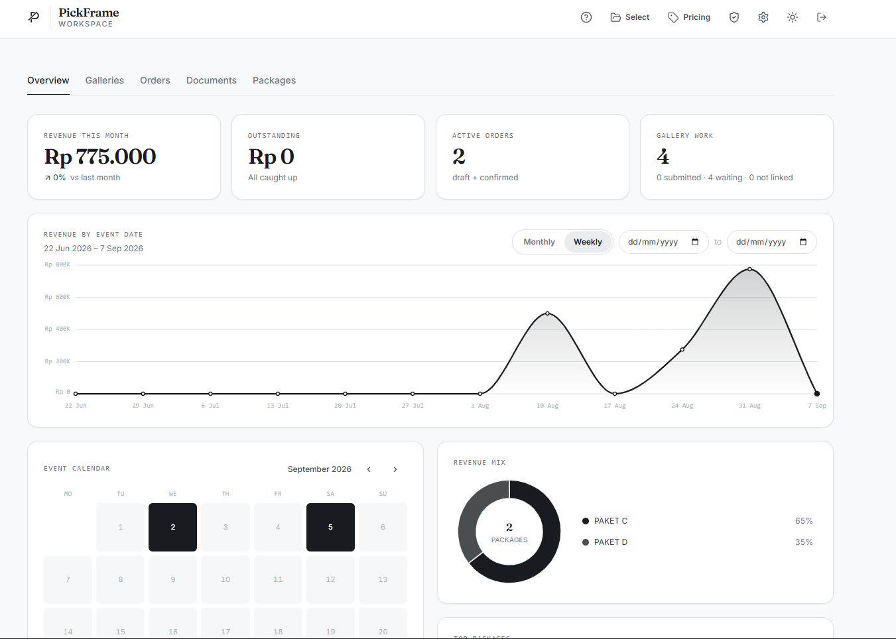
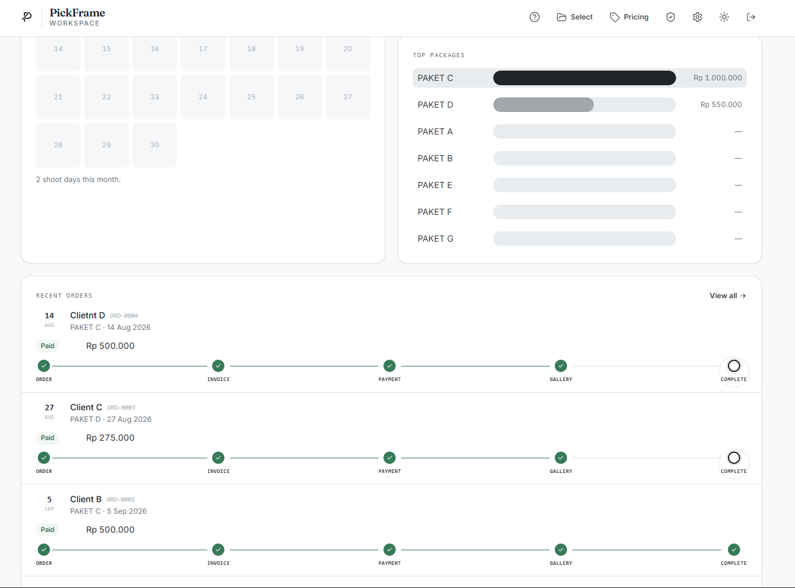
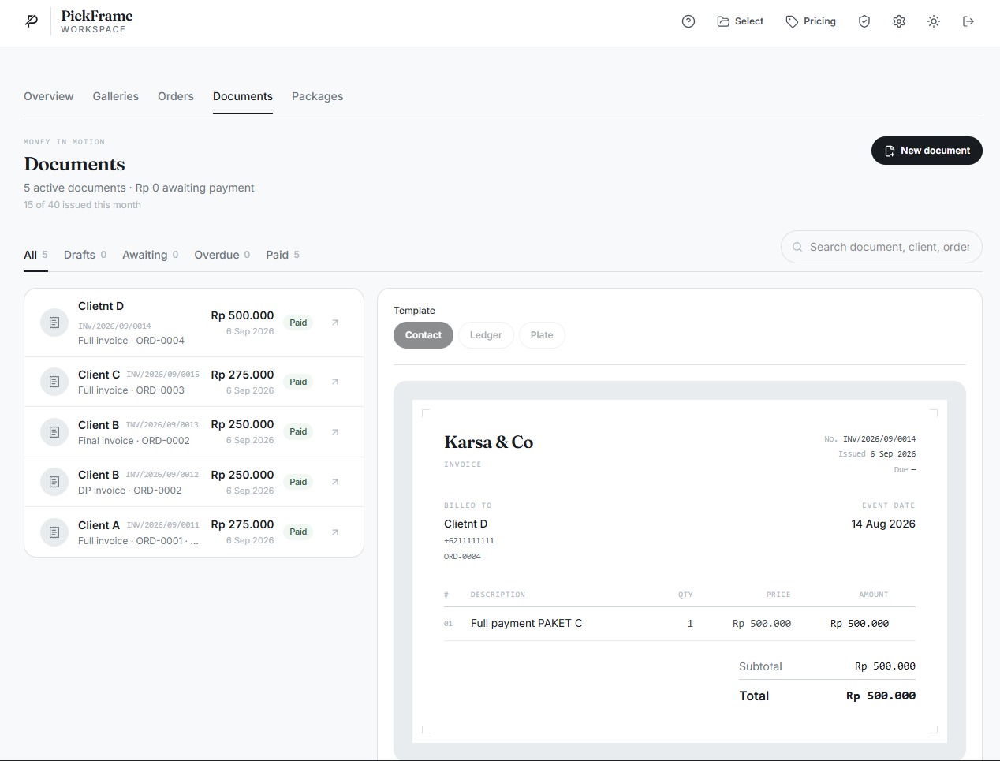
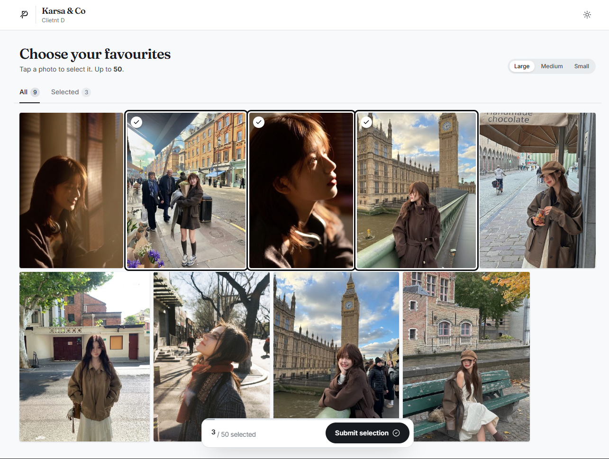
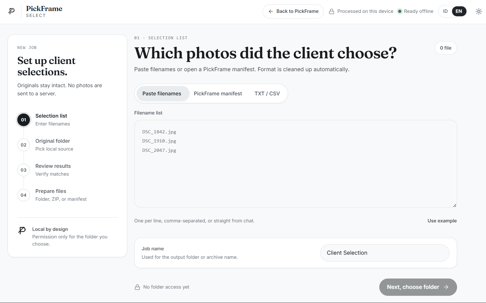
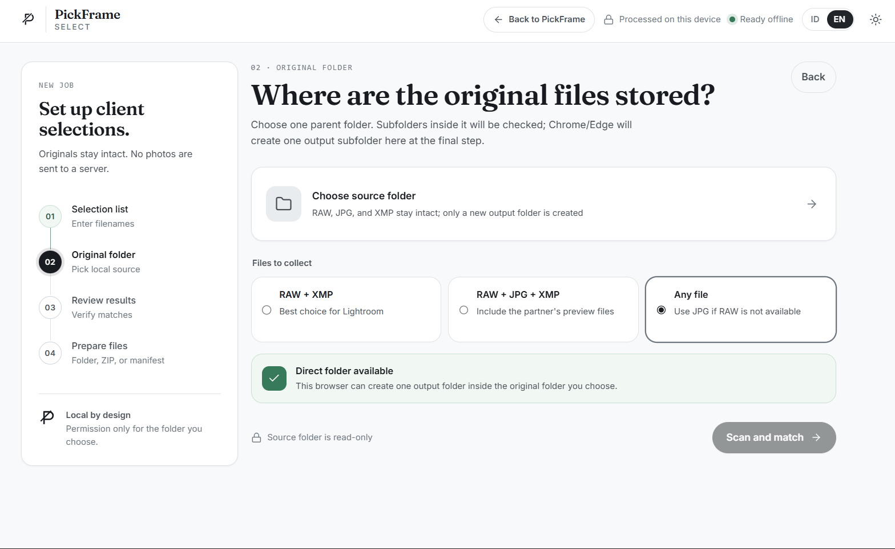

# PickFrame

**PickFrame** adalah SaaS multi-tenant untuk fotografer dan studio foto: jadwalkan sesi, simpan klien dan paket, hubungkan galeri Google Drive, terima pilihan foto klien lewat magic link, terbitkan invoice atau kuitansi, catat pembayaran, lalu baca laporan dan ekspor buku Excel.

Aplikasi ini **berjalan di produksi** dan digunakan studio foto nyata:

> **[pickframe.satuarah.click](https://pickframe.satuarah.click/)** | [Harga](https://pickframe.satuarah.click/pricing) | [Panduan](https://pickframe.satuarah.click/guide)

> ⚠ **Catatan penting** - Ini **bukan** repositori kode lengkap PickFrame. Kode lengkap aplikasi produksi tidak dipublikasikan. Repo ini adalah **portofolio**: penjelasan produk, arsitektur sistem, screenshot, dan **cuplikan kode terpilih** sebagai bukti kualitas engineering. Lihat [Lisensi](LICENSE).

## Apa yang PickFrame kerjakan

1. **Jadwalkan** sesi foto. Paket menentukan durasi, harga, dan pengaturan galeri; kontak WhatsApp klien tersimpan bersama proyek. Input cepat menerima daftar klien yang dapat diperiksa per baris.
2. **Kerjakan** dari daftar proyek atau kalender. Tiga tampilan workspace tersedia (bawaan, Studio Command/kalender, Permanent Studio/daftar berdampingan) dengan bahasa ID/EN serta tema terang/gelap/sistem.
3. **Bagikan galeri** dari folder Google Drive. Klien membuka tautan tanpa akun, memilih foto favorit, dan hasilnya tercatat di proyek. Foto asli tidak pernah meninggalkan Drive studio - API hanya membaca folder yang dibagikan.
4. **Terbitkan dokumen**: invoice DP, pelunasan, penuh, dan kuitansi. Dapat dicetak sebagai PDF atau diekspor PNG/JPG. Pembayaran dicatat terpisah dan tetap dapat dikoreksi.
5. **Ekspor laporan** sebagai buku Excel baru, atau perbarui buku Excel yang sudah ada tanpa menghilangkan perubahan pemiliknya.

| Tampilan | Cuplikan |
| --- | --- |
| Dashboard studio |  |
| Progres order & pembayaran |  |
| Invoice & kuitansi |  |
| Galeri pilihan klien |  |
| PickFrame Select - daftar berkas |  |
| PickFrame Select - pilih folder |  |

## Komponen sistem

| Komponen | Teknologi | Tugas |
| --- | --- | --- |
| **Portal web** | React 19, Vite, Tailwind CSS 4, Framer Motion | Landing, workspace studio, galeri klien, dokumen publik, ekspor Excel (ExcelJS) |
| **API** | Go 1.26, Gin, GORM, PostgreSQL | Auth JWT, kuota atomik, integrasi Google Drive, magic link, dokumen & pembayaran |
| **PickFrame Select** | PWA JavaScript murni, Service Worker | Pencocokan berkas RAW/JPG/XMP lokal di perangkat fotografer, tanpa unggah |
| **Infrastruktur** | Supabase (Auth + Postgres + RLS), Vercel, Cloudflare | Hosting, autentikasi, keamanan baris basis data |

## Arsitektur singkat

- **Autentikasi**: Supabase Auth menerbitkan JWT; backend Go memverifikasinya lewat **JWKS** (asimetris, algorithm confusion dicegah dengan whitelist `ES256`/`RS256`). Backend hanya memeriksa token - tidak pernah memegang kunci privat.
- **Akses tanpa akun**: galeri klien dan dokumen publik memakai **token yang dapat dicabut**, bukan akun. Percobaan menebak token di-rate-limit per IP dengan fixed-window upsert di PostgreSQL.
- **Multi-tenancy**: Row Level Security di PostgreSQL mengikat setiap baris ke `user_id`; middleware hanya menetapkan identitas, kepemilikan resource tetap diperiksa per query.
- **Kuota**: ditegakkan atomik per akun (Free/Pro/Studio + trial 24 jam), berganti mingguan.
- **Foto**: sumber kebenaran foto tetap di Google Drive studio; API membaca folder publik-link dan menyimpan referensi, bukan berkas.

Penjelasan lengkap ada di [ARCHITECTURE.md](ARCHITECTURE.md).

## Cuplikan kode terpilih

Beberapa file diambil apa adanya dari codebase produksi untuk menunjukkan standar kode dan pertimbangan keamanannya. Setiap file menonjolkan aspek berbeda:

| File | Aspek yang ditunjukkan |
| --- | --- |
| [`code/backend/middleware/auth.go`](code/backend/middleware/auth.go) | Verifikasi JWT Supabase via JWKS: whitelist algoritma (anti algorithm confusion), pemisahan `auth_unavailable` dari `unauthorized` agar outage JWKS tidak meng-logout seluruh pengguna, validasi `sub` sebagai UUID sebelum menyentuh Postgres |
| [`code/backend/middleware/ratelimit.go`](code/backend/middleware/ratelimit.go) | Rate limiting berbasis SQL upsert; resolusi IP klien yang tidak mempercayai `X-Forwarded-For` dari klien; hanya percobaan *gagal* yang dihitung agar pengguna sah tidak dicekik |
| [`code/backend/handlers/select_access.go`](code/backend/handlers/select_access.go) | Penerbitan sesi berumur pendek berbasis cookie `HttpOnly` untuk aplikasi pendamping, dengan pengecekan entitlement langganan |
| [`code/web/src/lib/orderMath.js`](code/web/src/lib/orderMath.js) | Aritmetika order & pembayaran yang dicerminkan persis antara frontend dan backend, lengkap dengan justifikasi tiap aturan (urutan pemeriksaan, perlakuan order bernilai nol, guard perubahan tambahan) |
| [`code/pickframe-select/src/core/matcher.js`](code/pickframe-select/src/core/matcher.js) | Mesin pencocokan berkas RAW/JPG/XMP di perangkat: penanganan ambiguitas nama sama di folder berbeda, pemeringkatan format RAW, dan de-dupe berbasis identitas |

## Mengapa kode lengkap tidak dipublikasikan

PickFrame adalah **produk komersial yang sedang berjalan**, bukan template open source. Memangkas keputusan lisensi dari kode yang sudah dirilis tidak mungkin dilakukan setelahnya: kode yang dirilis terbuka akan selamanya terbuka bagi siapa pun yang sudah menyalinnya.

Karena itu repo ini berisi cukup untuk **membaca dan menilai kualitas engineering** - deskripsi produk, arsitektur, dan cuplikan nyata - tanpa memberikan salinan yang dapat dijalankan sebagai layanan.

## Teknologi

## Lisensi

Copyright © 2026 **indraaryaLabs**. All rights reserved.

Repositori ini **source-available, bukan open source**: boleh dibaca dan dipelajari, tetapi **tidak** boleh dijalankan sebagai layanan, didistribusikan ulang, atau digunakan secara komersial tanpa izin tertulis. Lihat [LICENSE](LICENSE) untuk ketentuan lengkap.
